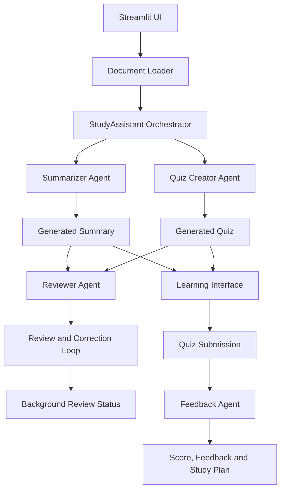

# AI Study Assistant — Multi-Agent Learning Platform

https://github.com/user-attachments/assets/8da383b5-2124-4474-9e24-1e948521d7fa

An AI-powered study assistant that converts learning material into structured summaries, interactive quizzes, and personalized study recommendations. Built using Python, Streamlit, and Groq LLMs, it leverages a multi-agent architecture to automate content generation, quality review, and learner assessment.

## Features

- **Document Processing:** Upload PDF, TXT, and Markdown files as learning material.
- **AI Summarization:** Generate structured summaries with key points and important terms.
- **Quiz Generation:** Automatically create interactive quizzes based on uploaded content.
- **Automated Review:** A dedicated Reviewer Agent evaluates generated content and coordinates corrections.
- **Background Execution:** Content review runs asynchronously, allowing users to access summaries and quizzes without waiting for the review process to finish.
- **Performance Evaluation:** Calculate quiz scores and provide question-wise feedback.
- **Personalized Study Plans:** Identify knowledge gaps and recommend areas for improvement.
- **Version-Aware Evaluation:** Preserve the quiz version used in an attempt to ensure accurate grading.

## Architecture

The application follows a multi-agent architecture coordinated by a central `StudyAssistant` orchestrator.



### Core Components

| Component | Responsibility |
|---|---|
| `app1.py` | Streamlit UI, document upload, navigation, quiz interaction, and feedback display. |
| `document.py` | Extracts and prepares text from uploaded documents. |
| `orchestrator1.py` | Coordinates agents, manages workflow execution, and handles evaluation. |
| Summarizer Agent | Generates structured summaries. |
| Quiz Creator Agent | Creates questions from the learning material. |
| Reviewer Agent | Reviews generated content and coordinates corrections. |
| Feedback Agent | Evaluates submissions and generates personalized feedback. |
| `llm.py` | Handles Groq API communication. |

## Workflow

1. **Upload:** The user uploads a document and optionally specifies a topic.
2. **Generate:** The orchestrator invokes the Summarizer and Quiz Creator agents.
3. **Review:** Once the content is generated, the Reviewer Agent starts in a background thread. It checks the output and coordinates corrections when required.
4. **Interact:** The user can access the summary and attempt the quiz while the review continues.
5. **Evaluate:** The Feedback Agent evaluates answers against the exact quiz version presented to the user.
6. **Improve:** The application displays scores, question-wise feedback, and a personalized study plan.

Background review updates are communicated through a thread-safe queue, keeping Streamlit UI updates separate from worker-thread execution.

## Technology Stack

| Technology | Purpose |
|---|---|
| Python | Core application and agent logic |
| Streamlit | Interactive web interface |
| Groq API | LLM inference |
| PyPDF | PDF text extraction |
| Threading & Queue | Asynchronous review and thread-safe communication |

## Project Structure

```text
study-assistant/
├── app1.py
├── study_assistant/
│   ├── __init__.py
│   ├── orchestrator1.py
│   ├── orchestrator.py
│   ├── agents.py
│   ├── document.py
│   └── llm.py
├── .env
├── .gitignore
├── requirements.txt
└── README.md
```

## Setup and Installation

**1. Clone the repository**

```bash
git clone <YOUR_GITHUB_REPOSITORY_URL>
cd study-assistant
```

**2. Create and activate a virtual environment**

```bash
python -m venv venv
venv\Scripts\activate
```

**3. Install dependencies**

```bash
pip install -r requirements.txt
```

**4. Configure Groq API credentials**

Create a `.env` file in the project root:

```env
GROQ_API_KEY=your_groq_api_key
```

**5. Run the application**

```bash
streamlit run app1.py
```

## Engineering Highlights

- **Modular Design:** Specialized agents separate content generation, review, and evaluation responsibilities.
- **Centralized Orchestration:** A single orchestrator manages agent coordination and workflow execution.
- **Asynchronous Processing:** Background review improves application responsiveness.
- **Thread-Safe Communication:** Queue-based status updates prevent worker threads from directly manipulating the UI.
- **Reliable Evaluation:** Quiz snapshots ensure submissions are graded against the correct question set.
- **Bounded Review Workflow:** Configurable review iterations prevent indefinite correction cycles.

## Future Enhancements

- Support for additional document formats.
- Configurable quiz difficulty and question types.
- Persistent storage of user progress and quiz history.
- Source references for generated content.
- Automated testing and cloud deployment.

---

**Built with Python, Streamlit, and Groq.**
